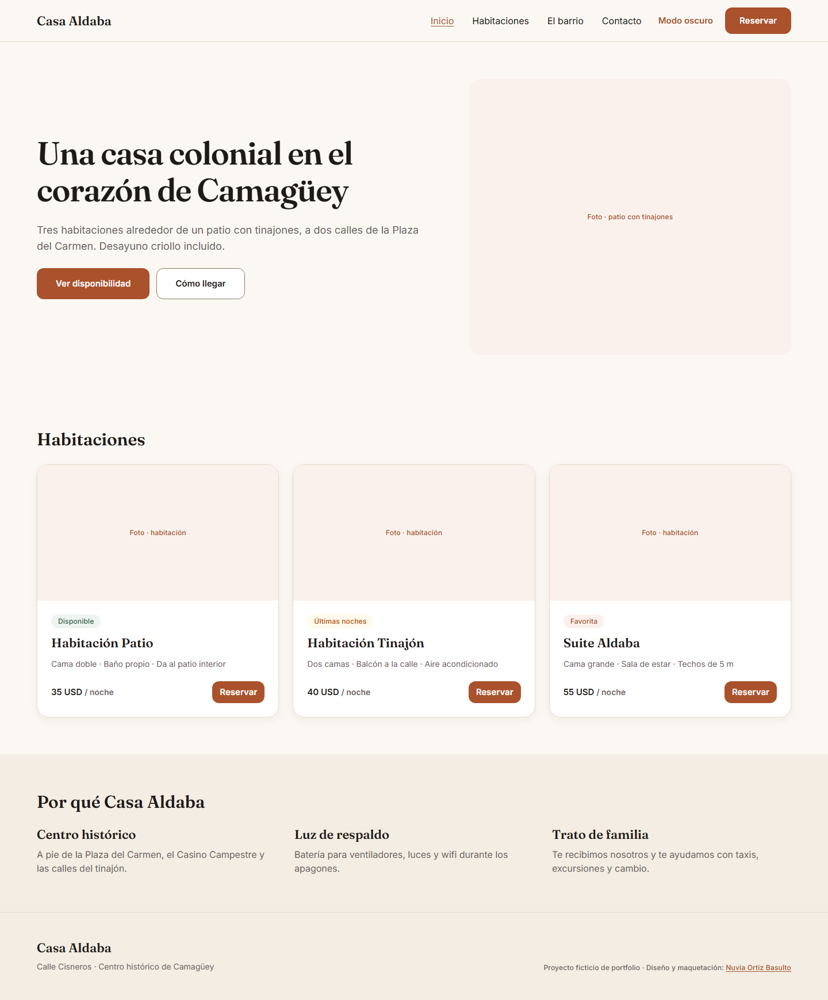
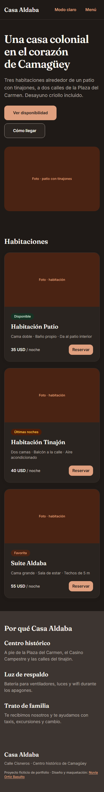

# Aldaba — sistema de diseño de Casa Aldaba

Proyecto de portfolio de diseño UI y maquetación. **Casa Aldaba** es una casa de huéspedes **ficticia** en el centro histórico de Camagüey: tres habitaciones alrededor de un patio con tinajones.

Inspiración visual: el barro de los tinajones (terracota), el verde de los patios interiores y la cal de las fachadas (arena). Titulares con serifa (Fraunces) y texto en Inter.

## Qué se genera en Figma

| Página | Contenido |
|---|---|
| 📕 Portada | Portada del archivo para Figma Community |
| 🎨 Fundamentos | Colores semánticos con su primitivo y su hex, escala tipográfica, espaciado y radios |
| 🧩 Componentes | **Button** (27 variantes: Primary, Secondary y Ghost × Sm, Md y Lg × Default, Hover y Disabled), **Input** (Default, Focus, Error, Disabled), **Badge** (4 tonos), **Room card**, **Navbar** y **Footer** (escritorio y móvil) |
| 📱 Pantallas | Inicio y Reservar en escritorio (1440) y móvil (390), más Inicio en **modo oscuro** |

Todo es nativo de Figma:
- **Variables:** 3 colecciones. Los primitivos; los semánticos con modos **Claro** y **Oscuro**; y espaciado y radios.
- **9 estilos de texto.**
- **Componentes con variantes y auto layout.**
- **Todos los colores, espaciados y radios enlazados a variables.** Cambiar un token actualiza todo el archivo.

## Cómo generarlo (unos 2 minutos)

1. Abre **Figma de escritorio** (los plugins en desarrollo no funcionan en el navegador) y crea un **archivo de diseño nuevo y vacío**.
2. Menú **Plugins → Development → Import plugin from manifest…** y elige `figma-plugin/manifest.json`.
3. Menú **Plugins → Development → Aldaba Design System**.
4. Espera el mensaje «Listo: Aldaba creado…».

Si aparece un error, abre **Plugins → Development → Show/Hide console** y copia el mensaje.

**Plan gratuito de Figma:** puede no permitir dos modos de variables. En ese caso el plugin crea todo sin el modo oscuro y lo avisa al terminar.

## Después de generarlo, a mano (aquí está el trabajo de diseño que se enseña)

1. **Fotos:** sustituye los recuadros «Foto · …» por fotos con licencia libre (Unsplash o Pexels) o propias. Basta con arrastrarlas encima del recuadro.
2. **Revisa el ritmo vertical y los saltos de línea** de los titulares en el móvil.
3. **Prototipo:** conecta «Ver disponibilidad» y «Reservar» con la pantalla Reservar. Añade la variante Hover con *While hovering*.
4. **Accesibilidad:** el texto principal y los botones superan la proporción de contraste 4.5:1 (calculada sobre los hex). Compruébalo también con un plugin de contraste (por ejemplo, Stark) y anota el resultado en el caso de estudio.
5. **Publicarlo en Figma Community** con la portada.

## Estado de las pruebas

- El plugin **se ha probado contra una simulación de la API de Figma**, que hace cumplir el orden de carga de fuentes, el auto layout para «llenar contenedor», las variantes válidas y las variables enlazadas.
- Se probaron tres casos: completo, plan sin modo oscuro y Figma sin la fuente Fraunces. Los tres terminan bien.
- **Todavía no se ha ejecutado en Figma real.** Si algo falla allí, el mensaje de la consola dice qué.

## Maquetación en HTML y CSS (`site/`)

Las pantallas Inicio y Reservar maquetadas **a mano, sin frameworks**: HTML semántico, CSS moderno (grid, `clamp()`, propiedades personalizadas) y unos 6 KB de JavaScript que solo añaden comodidad. Sin JavaScript, la web se navega y se lee entera.

<p>
  
  
  
</p>

- **Una sola fuente de verdad para los tokens:** `npm run tokens` genera `site/css/tokens.css` a partir de los tokens del plugin de Figma. La integración continua falla si no coinciden.
- **Modo oscuro:** sigue al sistema y además tiene un botón; la elección se recuerda.
- **Ligera:** unos 34 KB sin comprimir (unos 8 KB comprimida) entre HTML, CSS y JS de la portada, sin contar las fuentes de Google.
- **Formulario:** errores que explican cómo arreglarlos, un resumen de errores con enlaces a cada campo, `aria-invalid` y foco gestionado. El total se calcula según la habitación y las noches. **No envía nada:** es un proyecto de portfolio y lo dice.
- **Diferencia con el Figma, a propósito:** el campo único «Fechas» se convierte en dos campos de fecha nativos (Llegada y Salida). Son más accesibles y en el móvil abren el calendario del sistema.

### Ejecutar y probar

```bash
npm install
npm run serve            # http://localhost:4173
npm test                 # 27 pruebas: axe en claro y oscuro, móvil y escritorio, formulario, menú, peso
npm run tokens:check     # tokens CSS = tokens de Figma
node scripts/screenshots.mjs   # regenera las capturas de docs/ (con el servidor en marcha)
```

Hallazgos que corrigieron las pruebas y la revisión visual (contados en el caso de estudio):
- El texto secundario sobre el fondo de sección en modo oscuro daba 4.34:1 (lo detectó axe). Se creó tinta 200: ahora da 5.25:1.
- La regla `.btn` anulaba la que ocultaba «Menú» en escritorio y «Reservar» en el móvil. Se vio en las capturas y ahora hay una prueba que lo vigila.

Ver `CASO-DE-ESTUDIO.md` para el guion de la página del portfolio.
