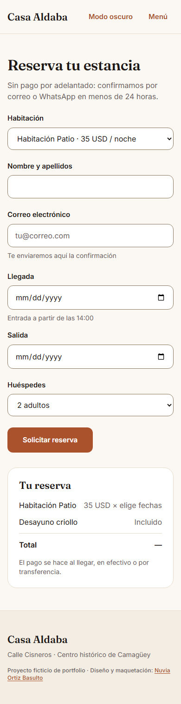

# Aldaba — design system for Casa Aldaba

A UI design and front-end portfolio project. **Casa Aldaba** is a **fictional** guesthouse in the old town of Camagüey, Cuba: three rooms around a courtyard with *tinajones*, the city's traditional clay water jars.

**Figma file:** [Aldaba — Design System](https://www.figma.com/design/TX6AvQohQD6dofHZ1TKATo/Aldaba-Design-System) (public, view-only) · **Live site:** https://nuvia-ortiz.github.io/aldaba/

Visual inspiration: the clay of the *tinajones* (terracotta), the green of the inner courtyards and the lime-washed façades (sand). Serif headings (Fraunces) and body text in Inter.

> **Español:** sistema de diseño y web de una casa de huéspedes ficticia en Camagüey. Un plugin de Figma propio genera variables, estilos, componentes y pantallas; la web está maquetada a mano en HTML y CSS con los mismos tokens y pruebas de accesibilidad.

## What the plugin builds in Figma

| Page | Contents |
|---|---|
| 📕 Cover and foundations | File cover and, beside it, semantic colours with their primitive and hex, type scale, spacing and radii |
| 🧩 Components | **Button** (27 variants: Primary, Secondary and Ghost × Sm, Md and Lg × Default, Hover and Disabled), **Input** (Default, Focus, Error, Disabled), **Badge** (4 tones), **Room card**, **Navbar** and **Footer** (desktop and mobile) |
| 📱 Screens | Home and Booking on desktop (1440) and mobile (390), plus Home in **dark mode** on plans that allow it |

Everything is native Figma:
- **Variables:** 3 collections. Primitives; semantic colours with **Light** and **Dark** modes; and spacing and radii.
- **9 text styles.**
- **Components with variants and auto layout.**
- **Every colour, spacing and radius bound to a variable.** Changing a token updates the whole file.

The public file was generated on Figma's Starter plan: 3 pages, 62 variables, 9 text styles, 8 components and 4 screens. That plan allows only one variable mode, so the plugin skips dark mode there and says so when it finishes. The website does have dark mode.

## How to generate it (about 2 minutes)

1. Open **Figma desktop** (plugins in development don't run in the browser) and create a **new, empty design file**.
2. **Plugins → Development → Import plugin from manifest…** and choose `figma-plugin/manifest.json`.
3. **Plugins → Development → Aldaba Design System**.
4. Wait for the message "Listo: Aldaba creado…".

If an error appears, open **Plugins → Development → Show/Hide console** and copy the message.

## How it was tested

- The plugin was first tested against a **mock of the Figma API** that enforces font loading order, "fill container" auto layout, valid variants and bound variables, in three cases: full, a plan without dark mode, and Figma without the Fraunces font.
- Then it was **run in real Figma**, which caught two problems the mock didn't: the Starter plan's 3-page limit, and `resize()` fixing the height of variant sets so only 6 of the 27 Button variants showed. Both are fixed in the plugin.

## Hand-coded HTML and CSS (`site/`)

The Home and Booking screens are built **by hand, with no framework**: semantic HTML, modern CSS (grid, `clamp()`, custom properties) and about 6 KB of JavaScript that only adds convenience. Without JavaScript the whole site can still be read and navigated.

<p>
  
  
  
</p>

- **One source of truth for tokens:** `npm run tokens` generates `site/css/tokens.css` from the Figma plugin's tokens. CI fails if they don't match.
- **Dark mode:** follows the system setting and also has a toggle; the choice is remembered.
- **Lightweight:** about 34 KB uncompressed (about 8 KB compressed) of HTML, CSS and JS for the home page, not counting Google Fonts.
- **Form:** error messages that say how to fix the problem, an error summary linking to each field, `aria-invalid` and managed focus. The total is calculated from the room and the number of nights. **It sends nothing:** it's a portfolio project and says so.
- **A deliberate difference from the Figma design:** the single "Dates" field becomes two native date fields (Arrival and Departure). They are more accessible and open the system calendar on mobile.

### Run and test

```bash
npm install
npm run serve            # http://localhost:4173
npm test                 # axe in light and dark, mobile and desktop, form, menu, no horizontal scroll, page weight
npm run tokens:check     # CSS tokens = Figma tokens
node scripts/screenshots.mjs   # regenerates the screenshots in docs/ (with the server running)
```

Findings that the tests and visual review caught:
- Secondary text on the section background in dark mode had a 4.34:1 contrast ratio (caught by axe). A new ink 200 token brings it to 5.25:1.
- The `.btn` rule overrode the one that hid "Menu" on desktop and "Book" on mobile. It showed up in the screenshots, and a test now guards it.

## License

[MIT](LICENSE).
